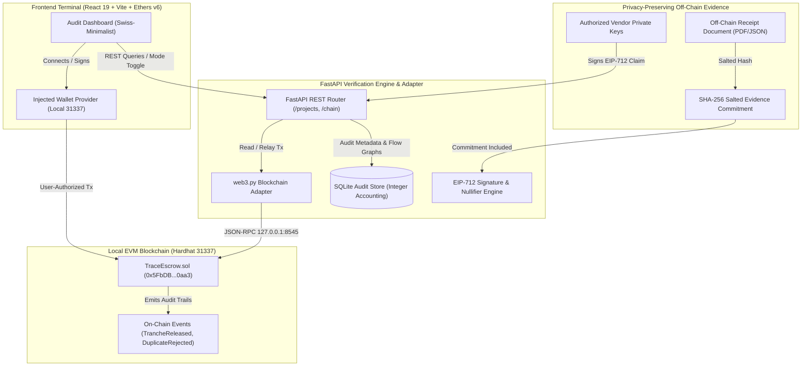

# TRACE: Verifiable NGO Fund Flows & Cryptographic Escrow
### CASCADE '26 Hackathon — Problem Statement 4.2: The Black Hole Ledger

> **Status: Web3 Escrow Integration & Design System Upgrade Complete**  
> Features purpose-bound Solidity escrow (`TraceEscrow.sol`), strict spend-gating, canonical EIP-712 expenditure verification, nullifier-based cross-report duplicate protection, dual execution modes (`simulation` and `local_chain`), and a Swiss-minimalist institutional audit dashboard verified with Impeccable design tooling.

---

## 1. Problem Statement & Mission

NGO donations frequently suffer from the **"black hole"** problem: once donated funds enter omnibus accounts, donors and evaluators lose visibility into how money is actually spent. Common systemic vulnerabilities include:
- **Duplicate invoice claims:** Re-submitting the same vendor receipt to multiple donor grant reports.
- **Off-purpose disbursements:** Diverting funds to unapproved categories without cryptographic constraints.
- **Unexplained transfers:** Fund leakage across intermediary bank accounts and opaque fiat conversions.
- **Unverifiable off-chain evidence:** Tampered receipts and altered payment amounts.

**TRACE** solves this by establishing purpose-bound programmatic escrow on an EVM ledger, requiring vendor-signed expenditure claims (EIP-712) with cross-report duplicate detection, multi-hop flow reconciliation, and an auditable institutional terminal.

---

## 2. Architecture & System Flow

TRACE separates off-chain verification and privacy-preserving document storage from on-chain monetary releases and nullifier tracking:



### Trust Boundaries & Key Invariants
1. **Solidity-Enforced Spend Gate:** Tranche 1 is released at project initialization. Tranche $N$ ($N \ge 2$) is strictly locked by the smart contract until cumulative verified expenditure ($\text{verifiedSpendWei}$) meets or exceeds previously released funds ($\text{releasedWei}$).
2. **Global Invoice Nullifier:** Canonical nullifiers are deterministically computed as $\text{keccak256}(\text{abi.encode}(\text{vendorId}, \text{invoiceId}))$. An invoice can **never** be accepted twice, even across distinct reports or projects.
3. **Fail-Closed Execution:** Reverted transactions or RPC timeouts never fall back to simulated release. Failures are reported with exact revert reasons.
4. **Privacy Preservation:** Sensitive receipt PDFs, beneficiary identities, and private vendor salts remain off-chain; only SHA-256 evidence commitments and nullifiers are recorded on-chain.
5. **No Floating-Point Math:** All accounting in smart contracts, SQLite, and Python uses exact integer units (wei or integer USD cents).

---

## 3. Technology Stack

| Layer | Technology | Version | Purpose |
|---|---|---|---|
| **Smart Contracts** | Solidity | `0.8.28` | Spend-gated escrow, nullifier registry, EIP-712 verification |
| **Blockchain Dev** | Hardhat | `2.29.1` | Local EVM compilation, testing, and deployment |
| **Local Node** | Hardhat Network | Chain ID `31337` | Local JSON-RPC provider at `http://127.0.0.1:8545` |
| **Backend Runtime** | Python | `3.14.2` | High-performance Python async runtime |
| **Backend Framework** | FastAPI | `0.162.0` | Asynchronous REST API |
| **Validation** | Pydantic | `2.14.1` | Schema serialization and strict validation |
| **Web3 Client** | web3.py | `8.0.0` | Node connectivity, contract reads, and transaction execution |
| **Cryptographics** | eth-account | `0.14.0` | EIP-712 signature parsing and address recovery |
| **Frontend Runtime** | React 19 + Vite | `19.3.1` / `8.3.5` | Reactive client UI |
| **Web3 Frontend** | Ethers.js | `6.16.0` | Injected browser wallet connector and contract calls |
| **Design Tooling** | Impeccable | `4.7.0` | Institutional UX critique, contrast, and audit tool |
| **Database** | SQLite | Python `sqlite3` | Deterministic simulation and immutable audit trail |

---

## 4. Local Development & Startup Guide

### Prerequisites
- **Node.js** `v24.12.0` or higher and `npm 11.6.2`
- **Python** `3.14.2` with virtualenv support
- **Git**

### Step 1: Start the Local Hardhat Node
In a dedicated PowerShell terminal:
```powershell
cd contracts
npx hardhat node
```
*The local node starts at `http://127.0.0.1:8545/` on Chain ID `31337`.*

### Step 2: Compile & Deploy TraceEscrow Contract
In a second PowerShell terminal:
```powershell
cd contracts
npx hardhat compile
npx hardhat run scripts/deploy.js --network localhost
```
*Outputs deployed contract address: `0x5FbDB2315678afecb367f032d93F642f64180aa3` and automatically synchronizes ABI to `frontend/src/contracts/TraceEscrow.json`.*

### Step 3: Start the FastAPI Backend
In a third PowerShell terminal:
```powershell
cd backend
.\.venv\Scripts\Activate.ps1
uvicorn backend.app.main:app --port 8000
```
*API is accessible at `http://127.0.0.1:8000` (docs at `http://127.0.0.1:8000/docs`).*

### Step 4: Start the Frontend Application
In a fourth PowerShell terminal:
```powershell
cd frontend
npm run dev
```
*Dashboard opens at `http://localhost:5173/`.*

---

## 5. Dual Operational Modes

The dashboard features an explicit header toggle between two operational environments:

| Feature | `simulation` Mode | `local_chain` Mode |
|---|---|---|
| **Underlying Vault** | Deterministic Python / SQLite state machine | Deployed Solidity contract `TraceEscrow.sol` |
| **Release Authority** | Local simulation rules engine | On-chain operator transaction or connected wallet |
| **Accounting Ledger** | SQLite `projects` & `flow_events` tables | EVM contract storage & confirmed transaction receipts |
| **Spend Gating** | Python constraint checker | Solidity contract `revert InsufficientVerifiedSpend()` |
| **Nullifier Enforcement**| SQLite unique index on canonical nullifiers | Solidity mapping `seenNullifiers[nullifier]` |
| **Use Case** | Rapid hackathon scenario evaluation | Live local blockchain verification & wallet inspection |

---

## 6. Running Tests

### 1. Smart Contract Tests (Hardhat)
```powershell
cd contracts
npx hardhat test
```
*Passes 15/15 tests covering project initialization, spend-gated releases, duplicate nullifier freezes, EIP-712 authentications, tampered receipt rejections, and emergency sweeps.*

### 2. Backend Test Suite (Pytest)
```powershell
backend\.venv\Scripts\pytest backend\tests -v
```
*Passes 134/134 tests covering cryptographic verification, canonical invoice identity, API routes, Web3 adapter, fail-closed mechanics, and live chain integration.*

### 3. Frontend Lint & Production Build
```powershell
cd frontend
npm run lint    # oxlint: 0 errors, 0 warnings
npm run build   # vite build: production bundle verified
```

### 4. Design System Audit (Impeccable)
```powershell
.agents\skills\impeccable\scripts\impeccable.cmd detect http://localhost:5173/
```
*Verifies 0 design anti-patterns, compliant WCAG AA contrast (5.5:1+), flat hierarchy, and valid typography.*

---

## 7. Security Warnings & Trust Assumptions

> [!WARNING]
> **Development Keys & Local RPC:**  
> The private keys configured in Hardhat accounts (e.g. Account #0 `0xac09...`, Account #1 `0x59c6...`) are **publicly known test fixtures**. Never send real funds to these addresses on public networks.

> [!IMPORTANT]
> **Trust Boundaries:**  
> `TraceEscrow.sol` enforces release constraints based on verified expenditure claims and authorized verifier attestations. The blockchain proves that valid signatures and non-replayed nullifiers were provided; it does not independently prove real-world delivery of physical supplies without trustworthy sensor, vendor, or evaluator attestations.

---

## 8. License & Acknowledgements

Developed for **CASCADE '26 Hackathon — Problem Statement 4.2: The Black Hole Ledger**.  
Built with FastAPI, Solidity, Hardhat, web3.py, React, Ethers.js, and Impeccable.
