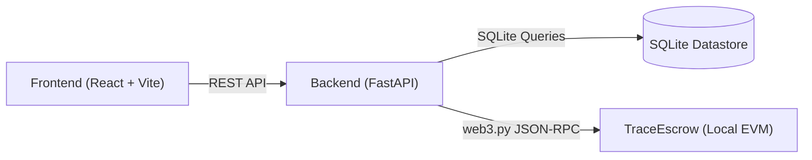

# TRACE: Verifiable NGO Fund Flows
### CASCADE '26 Hackathon — Problem Statement 4.2: The Black Hole Ledger

> **Current Implementation Status:** **Phase 0 Complete (Toolchain Verified)**  
> Application features (escrow smart contract, API endpoints, signing services, database migrations, and dashboard UI) are **not yet implemented**. Only repository foundation and toolchain smoke tests have been executed and verified.

---

## 1. Problem Statement

NGO donations frequently suffer from the "black hole" problem: once funds enter an organization's omnibus accounts, donors lose visibility into how money is actually spent. Common vulnerabilities include:
- **Duplicate invoice claims:** Submitting the same vendor receipt to multiple donor reports.
- **Off-purpose disbursements:** Diverting funds to unapproved categories.
- **Unexplained transfers:** Fund leakage across intermediary bank accounts and shell entities.
- **Unverifiable off-chain evidence:** Tampered receipts and unverifiable vendor claims.

TRACE solves this by enforcing purpose-bound cryptographic escrow on an EVM ledger, requiring vendor-signed expenditure receipts (EIP-712) with cross-report duplicate detection, multi-hop reconciliation, and an exploratory audit dashboard.

---

## 2. Product Objective & Planned MVP

The eventual TRACE system demonstrates:
1. **Vendor-Signed Expenditure Receipts:** Cryptographic claims signed by authorized vendors using EIP-712 typed structured data.
2. **Global Duplicate Invoice Detection:** Nullifier registry based on canonical vendor identity and invoice number to prevent cross-report double-claiming.
3. **Purpose-Bound On-Chain Escrow:** Smart contract-enforced release rules based on category budgets, remaining balances, and vendor registration.
4. **Multi-Hop Fund-Flow Tracing:** Directed graph reconstruction of allocations and payments with conservation-of-flow accounting.
5. **Off-Chain Evidence Commitments:** Privacy-preserving salted document hashes anchoring sensitive receipts without leaking beneficiary data.
6. **Simulated External Systems:** Explicitly labelled simulations of secondary chains, relayers, and fiat off-ramps.
7. **Exploratory Audit Dashboard:** Real-time visibility into project allocations, transaction graphs, verification warnings, and audit logs.
8. **Adversarial Security Suite:** Automated tests demonstrating resilience against forged signatures, duplicate invoices, budget overruns, and front-running.

---

## 3. Technology Stack (Locked & Verified)

| Layer | Technology | Verified Resolved Version | Notes |
|---|---|---|---|
| **Smart Contracts** | Solidity | `0.8.28` (EVM: Paris) | Compiled via Hardhat |
| **Framework** | Hardhat 2 | `hardhat@2.29.1` (pinned exact) | JavaScript project, not TypeScript |
| **Toolbox** | Hardhat Toolbox | `@nomicfoundation/hardhat-toolbox@5.0.0` | Ethers v6, Chai |
| **Local Node** | Hardhat Local EVM | Chain ID `31337` | Local JSON-RPC at `127.0.0.1:8545` |
| **Backend Runtime** | Python | `3.14.2` | Local `.venv` isolated environment |
| **API Framework** | FastAPI | `fastapi==0.162.0` | High-performance async REST API |
| **Data Validation** | Pydantic | `pydantic==2.14.1` | Canonical schema validation |
| **Server** | Uvicorn | `uvicorn==0.54.0` | ASGI server |
| **Web3 Client** | web3.py | `web3==8.0.0` | JSON-RPC interaction |
| **Key & Signatures** | eth-account | `eth-account==0.14.0` | EIP-712 signature verification |
| **Test Runner** | pytest | `pytest==9.1.1` | Backend automated testing |
| **Frontend Framework** | React | `19.3.1` (JavaScript/JSX) | Not TypeScript |
| **Bundler & Tooling**| Vite | `8.3.5` | Fast ESM build pipeline |
| **Database (Planned)**| SQLite | Python standard `sqlite3` | Exact integer accounting |

---

## 4. Architecture Overview

TRACE is architected into four strict layers:



- **Frontend (`frontend/`):** Consumes the backend REST API to render project statuses, receipt claims, transfer flowcharts, and audit logs. The frontend has **no direct database access**.
- **Backend (`backend/`):** Validates receipt requests, computes canonical nullifiers, tracks multi-hop transfers, logs audit trails, and interacts with the blockchain. The backend prepares claims but does not act as sole release authority.
- **Smart Contracts (`contracts/`):** Deployed to local Hardhat node. Autonomous enforcement of vendor registry, EIP-712 receipt signatures, global invoice nullifiers, and escrow release rules.
- **Database (`backend/data/`):** SQLite database for project metadata, transfer graph edges, and evidence references. Monetary figures are strictly stored in integer units (wei or integer cents).

For complete design details, component boundaries, and security invariants, see [docs/architecture.md](docs/architecture.md).

---

## 5. Phase Roadmap & Approval Policy

Development follows a strict, gated phase model. **No phase may begin without explicit human reviewer sign-off.**

| Phase | Description | Status |
|---|---|---|
| **Phase 0** | Environment, repository hygiene, architecture docs, and toolchain smoke tests | **COMPLETED & VERIFIED** |
| **Phase 1** | Canonical receipt schema, EIP-712 signatures, invoice identity, duplicate detection unit tests | *Pending Review Approval* |
| **Phase 2** | Solidity escrow contract (`TraceEscrow.sol`), signature enforcement, nullifiers, release rules, contract tests | *Planned* |
| **Phase 3** | FastAPI REST endpoints, SQLite schema, web3.py integration, end-to-end backend tests | *Planned* |
| **Phase 4** | Multi-hop flow reconciliation, simulated second-chain & fiat off-ramp events, privacy commitments | *Planned* |
| **Phase 5** | React + Vite audit dashboard, transfer graph visualization, REST API integration | *Planned* |
| **Phase 6** | Adversarial test suite, synthetic demo dataset, benchmark metrics, spot-audit walkthrough | *Planned* |

---

## 6. Phase 0 Verification & Smoke Test Results

All Phase 0 toolchain components have been verified locally on Windows:

| Component | Check | Command Executed | Result | Output Details |
|---|---|---|---|---|
| **Contracts** | Version Verification | `npx hardhat --version` | **PASS** | `2.29.1` |
| **Contracts** | Compilation | `npx hardhat compile` | **PASS** | Downloaded `solc 0.8.28`, compiled 1 file (EVM: paris) |
| **Contracts** | Sample Test Suite | `npx hardhat test` | **PASS** | 1 passing (794ms) |
| **Backend** | Dependency Imports | `python -c "import fastapi, uvicorn, pydantic, web3, eth_account; print('BACKEND_IMPORTS_OK')"` | **PASS** | `BACKEND_IMPORTS_OK` |
| **Backend** | Test Runner | `pytest --version` | **PASS** | `pytest 9.1.1` |
| **Backend** | Pytest Execution | `pytest tests/test_smoke.py` | **PASS** | `1 passed in 2.66s` |
| **Frontend** | Production Build | `npm run build` | **PASS** | Vite built client in 234ms (`dist/index.html`, assets) |
| **Integration**| Local EVM Node | `npx hardhat node` | **PASS** | Node started at `127.0.0.1:8545` |
| **Integration**| Python Web3 RPC | `python smoke_chain_connectivity.py` | **PASS** | `WEB3_CONNECTED: True`, `CHAIN_ID: 31337`, `BLOCK: 0` |
| **Integration**| Clean Shutdown | Process termination & TCP check | **PASS** | Port 8545 cleanly released |

---

## 7. Local Setup Instructions

### Prerequisites
- Node.js `v24.12.0` and npm `11.6.2`
- Python `3.14.2` and pip `26.2.1`
- Git `2.51.0`

### Contracts Setup
```bash
cd contracts
npm install
npx hardhat test
```

### Backend Setup
```bash
cd backend
python -m venv .venv
# Windows PowerShell:
.\.venv\Scripts\Activate.ps1
pip install -r requirements.txt
pytest
```

### Frontend Setup
```bash
cd frontend
npm install
npm run build
```

---

## 8. Security & Privacy Notice

- **No Secrets in Repo:** Real private keys, credentials, and live API tokens must never be committed. See `.env.example` for required configuration keys.
- **Offline Caveat:** Initial contract compilation required an internet connection to fetch Solidity compiler `0.8.28`. Subsequent compiles on this machine use the local cache at `%LOCALAPPDATA%\hardhat-nodejs\Cache\compilers-v2`.
