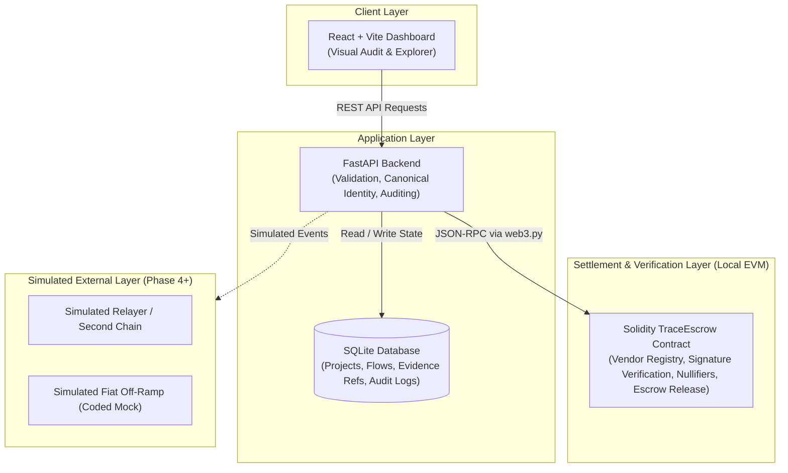
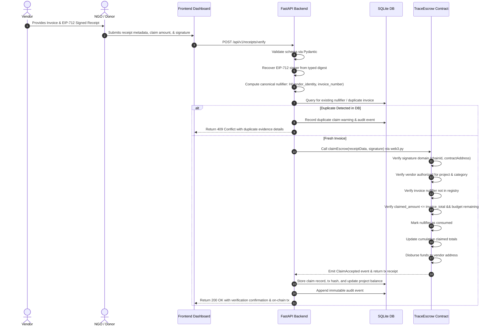
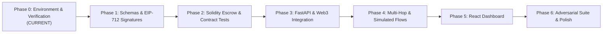

# TRACE Architecture Document
**CASCADE '26 Hackathon — Problem Statement 4.2: The Black Hole Ledger — Verifiable NGO Fund Flows**

> **Current Implementation Status (Phase 0):**
> This document specifies the *target design and planned architecture* for TRACE. As of Phase 0, application features (smart contracts, API endpoints, signing mechanisms, and dashboard UI) are **not yet implemented**. Only toolchain verification and environment setup are active.

---

## 1. System Overview

TRACE is an end-to-end verifiable fund-tracking prototype designed to eliminate "black hole" NGO accounting where donations disappear into opaque omnibus pools. TRACE enables donors, project managers, and auditors to verify that allocated funds are disbursed strictly against cryptographic, vendor-signed expenditure claims, while detecting duplicate claims across disjoint donor reports and tracing multi-hop fund flows.



---

## 2. Component Responsibilities & Boundaries

### A. Frontend (React + Vite)
- **Role:** Pure client presentation and exploratory audit interface.
- **Responsibilities:**
  - Display project allocations, escrow balances, and category budgets.
  - Interactive fund-flow graph and transaction timeline.
  - Receipt submission form and cryptographic verification feedback.
  - Prominent visual warnings for duplicate claims, unapproved vendors, and policy violations.
  - Audit log explorer and multi-hop reconciliation reports.
  - Clear visual badges distinguishing local EVM on-chain state from simulated cross-chain/fiat off-ramps.
- **Architectural Boundary:** The frontend communicates **strictly via the documented FastAPI REST API**. It **must never connect directly to SQLite or bypass backend validation**.

### B. Backend (Python + FastAPI)
- **Role:** Orchestration, receipt preparation, canonical identity normalization, off-chain indexing, and audit logging.
- **Responsibilities:**
  - Request parsing and schema validation using Pydantic.
  - Off-chain vendor signature verification (EIP-712).
  - Canonical invoice identity generation and cross-project duplicate detection.
  - Maintenance of project records, transfer edges, and parent-child transaction links.
  - Multi-hop fund flow reconciliation and balance conservation checks.
  - Audit event generation and tamper-evident logging.
  - Blockchain transaction preparation and read queries using `web3.py`.
  - Evidence document hashing and privacy-preserving commitment metadata.
- **Architectural Boundary:** The backend **prepares and explains claims**, but **is not the sole authority for security-critical on-chain fund releases**. Critical authorization and duplicate nullifiers are contract-enforced.

### C. Smart Contracts (Solidity + Hardhat 2)
- **Role:** On-chain settlement, cryptographic policy enforcement, and immutable state machine.
- **Responsibilities:**
  - Vendor registration and authorization per project/category.
  - Purpose-bound escrow vault holding donation funds.
  - On-chain EIP-712 vendor receipt signature validation using `ecrecover`.
  - Global invoice nullifier registry (`bytes32 nullifier => bool used`) preventing double-spend across different donor reports.
  - Cumulative claim limits per invoice and project category.
  - Escrow release logic releasing funds directly to authorized vendor addresses.
  - Emergency project freeze and multi-party controlled unfreeze mechanisms.
  - Comprehensive event emission (`ClaimAccepted`, `ClaimRejected`, `ProjectFrozen`, `FundsReleased`).
- **Architectural Boundary:** The smart contract **enforces critical rules autonomously**. It does not trust off-chain backend assertions without verifiable cryptographic proof.

### D. Database (SQLite)
- **Role:** Queryable local datastore for indexed events, project metadata, and evidence references.
- **Responsibilities:**
  - Normalized project records, donor allocations, and expenditure budgets.
  - Directed graph representation of fund-flow hops (parent transaction IDs, hop depth).
  - Off-chain receipt metadata, file digests (SHA-256), and salt commitments.
  - Verification outcomes, failure reasons, and rule violations.
  - Immutable audit trail records.
- **Architectural Boundary:** Financial accounting in SQLite strictly uses **integer representations** (e.g., wei or integer cents), never IEEE 754 floating-point numbers.

---

## 3. Data Flow: Future Receipt Claim Verification (Planned for Phase 1–3)

The end-to-end receipt claim verification workflow operates across off-chain and on-chain boundaries:



---

## 4. Security Boundaries & Invariants

1. **Global Invoice Nullifier (Cross-Report Protection):**
   - The invoice nullifier is derived from the **canonical vendor identity and invoice number**:
     $$\text{nullifier} = \text{keccak256}(\text{abi.encodePacked}(\text{vendorAddress}, \text{canonicalInvoiceId}))$$
   - **Crucially, the nullifier is NOT derived from `projectId`**. If an NGO attempts to submit the same vendor invoice to Project Alpha and Project Beta, the on-chain contract will reject the second claim immediately because the nullifier is already marked as consumed.

2. **Domain-Bound Signatures (EIP-712):**
   - Signatures are bound to an EIP-712 domain separator including `chainId` and `verifyingContract`. A receipt signed for a local testnet cannot be replayed on mainnet or on an unauthorized contract.

3. **Separation of Invoice Total and Claimed Amount:**
   - The signed receipt schema explicitly contains both `invoice_total` and `claimed_amount`. The smart contract and backend enforce that the cumulative claimed amount across all claims on a single invoice cannot exceed `invoice_total`.

4. **Off-Chain Evidence & Privacy-Preserving Commitments:**
   - High-resolution invoice PDFs, itemized line items, and sensitive beneficiary identifiers remain off-chain.
   - When required for auditability, off-chain evidence is represented on-chain via salted cryptographic commitments:
     $$\text{commitment} = \text{keccak256}(\text{abi.encodePacked}(\text{documentHash}, \text{salt}))$$
   - No claim of zero-knowledge proofs, complete anonymity, or physical delivery verification is made unless explicitly implemented and tested.

5. **Exact Arithmetic:**
   - All monetary calculations across smart contracts, Python backend, and database are executed in integer units (wei or integer cents) to prevent rounding drift or precision loss.

---

## 5. Simulated vs. Real Functionality (Honesty Matrix)

TRACE clearly labels every subsystem to distinguish what is cryptographically real from what is a simulated demonstration component:

| Subsystem | Execution Model | Cryptographic / Real Properties | Simulation / Mock Properties |
|---|---|---|---|
| **TraceEscrow Contract** | Local EVM (Hardhat Node) | Real EVM execution, real state transitions, real EIP-712 ECDSA signature checks, real storage nullifiers. | Deployed to local development network (`localhost:8545`, Chain ID 31337). |
| **Vendor Signature Verification** | Python `eth-account` + Solidity `ecrecover` | Mathematically valid cryptographic curve operations (secp256k1). | Test keys generated deterministically for testing. |
| **Receipt Nullifier Registry** | Smart Contract Storage | Real collision-resistant keccak256 nullifier tracking. | Local chain storage. |
| **Second Chain / Relayer (Phase 4)** | Backend Simulation Script | None (explicitly simulated). | Relayed transactions between chains are simulated via deterministic logs. No real cross-chain bridge exists. |
| **Fiat Off-Ramp (Phase 4)** | Backend Mock Service | None (explicitly simulated). | Banking API webhooks and fiat disbursement events are synthetic mock records. No real fiat movement occurs. |
| **Off-Chain Evidence Delivery** | SHA-256 Digest & Salt | Real SHA-256 document hashing. | Proves file integrity only; does not prove physical delivery of goods in the real world. |

---

## 6. Gated Implementation Roadmap

Development proceeds strictly through gated phases. Transition to each subsequent phase requires explicit human review and approval against verified acceptance criteria:



- **Phase 0 (Active):** Environment setup, repository hygiene, architecture documentation, and toolchain smoke testing (Hardhat 2, Python virtual environment, React/Vite build, local node connectivity).
- **Phase 1 (Pending Review):** Canonical receipt schema, EIP-712 typed data definitions, invoice identity normalization, and signature/duplicate detection unit tests.
- **Phase 2 (Pending Phase 1):** Solidity escrow implementation (`TraceEscrow.sol`), signature enforcement, nullifier registry, cumulative claim limits, freeze/release rules, and comprehensive contract test suite.
- **Phase 3 (Pending Phase 2):** FastAPI REST backend, SQLite schema, web3.py contract client, and end-to-end integration tests.
- **Phase 4 (Pending Phase 3):** Multi-hop fund-flow reconciliation, flow conservation checks, simulated second-chain/fiat off-ramp event generator, and privacy commitments.
- **Phase 5 (Pending Phase 4):** React + Vite dashboard, transfer graph visualization, audit log interface, and REST API integration.
- **Phase 6 (Pending Phase 5):** Adversarial test suite (forged signatures, replay attacks, duplicate claims), fixed demonstration dataset, benchmark metrics, and spot-audit judge walkthrough.

---

## 7. Milestone 1 (M1): First End-to-End Backend Prototype

### 7.1 Overview & Architecture Boundaries
Milestone 1 implements the first complete vertical slice of the TRACE backend on top of Phase 1 cryptographic verification:
1. **Persistence Layer (`backend/app/db.py`):** Transaction-safe SQLite storage with 7 core tables (`projects`, `vendors`, `claims`, `invoice_ledger`, `escrow_state`, `flow_events`, `audit_events`).
2. **Simulated Escrow (`backend/app/services/escrow_sim.py`):** Enforces purpose-bound tranche disbursement without on-chain settlement. Seeded with `WATER-001` (50 ETH, 5 tranches, 1 ETH = $2,000 USD).
3. **Multi-Hop Fund Flow Reconciliation (`backend/app/services/trace_graph.py`):** Directed acyclic graph tracking fund lifecycle from genesis donations through allocations, bridges, off-ramps, and vendor claims with integer conservation checks.
4. **FastAPI REST API (`backend/app/main.py`):** High-performance endpoints with Pydantic request/response validation, CORS support for Vite, and structured error reporting.
5. **Adversarial Scenarios & Test-Only Vendors (`backend/app/demo/`):** Repeatable execution of 6 core attack and benign scenarios.

### 7.2 Transaction Semantics & Failure Modes
- **Atomic Operations:** All claim submissions and tranche releases execute inside explicit SQLite transactions (`with conn:`).
- **Security Rejection Isolation:** When a qualifying security violation occurs (`SIGNER_VENDOR_MISMATCH`, `SIGNATURE_INVALID`, `MALFORMED_SIGNATURE`, `INVOICE_REUSED_ACROSS_REPORTS`, `INVOICE_TOTAL_MISMATCH`, `CATEGORY_NOT_ALLOWED`, `EVIDENCE_COMMITMENT_MISMATCH`):
  - The rejection is recorded in `audit_events`.
  - The offending project is marked `is_frozen = 1` with an immutable freeze reason.
  - A `PROJECT_FROZEN` audit event is emitted.
  - **Zero Partial Writes:** No records are inserted into `claims`, no modifications occur in `invoice_ledger`, and verified spend totals are left completely untouched.
- **Cross-Report Protection:** Duplicate submissions of the same vendor invoice across different reports or projects are blocked via canonical nullifiers (`keccak256(abi.encode(vendorId, invoiceId))`), freezing the project attempting reuse without affecting the original project.

### 7.3 REST Endpoint Contract Summary

| Method | Endpoint | Description | Success Code | Error Code |
|---|---|---|---|---|
| `GET` | `/health` | Service health, simulation mode, and database status | 200 OK | — |
| `GET` | `/projects` | List all projects with budgets, spend, and freeze status | 200 OK | — |
| `GET` | `/projects/{id}` | Detailed project metadata and escrow state | 200 OK | 404 Not Found |
| `GET` | `/projects/{id}/trace` | Fund-flow directed graph with conservation checks | 200 OK | 404 Not Found |
| `POST` | `/claims` | Submit vendor receipt for Phase 1 cryptographic verification | 200 OK | 400 Bad Request / 409 Conflict |
| `POST` | `/projects/{id}/release` | Release next tranche if verified spend covers prior releases | 200 OK | 400 Bad Request |
| `GET` | `/audit` | Filterable query of immutable audit log entries | 200 OK | — |
| `GET` | `/metrics` | Security and accounting metrics from persisted records | 200 OK | — |
| `POST` | `/demo/reset` | Deterministically reset database to initial seed state | 200 OK | — |
| `GET` | `/demo/scenarios` | Catalog of available attack and evaluation scenarios | 200 OK | — |
| `POST` | `/demo/scenarios/{name}/run` | Execute automated demo scenario against database | 200 OK | 404 Not Found |

### 7.4 Simulated Components & Hackathon Limitations
- **Simulated Escrow:** The escrow vault runs in Python/SQLite. On-chain EVM enforcement (`TraceEscrow.sol`) is scheduled for Phase 2.
- **Simulated Bridge & Off-ramp:** Layer 2 bridging (Arbitrum) and fiat off-ramping (Circle Mint) are synthetic demonstration records carrying test attestations. No actual fiat or cross-chain bridge assets are moved.
- **Unfreeze Mechanism:** Emergency freezing is fully automated. Multi-sig / DAO unfreeze voting is documented for later milestones.

### 7.5 Exact Commands
```powershell
# 1. Activate environment and run full test suite (112 tests)
backend\.venv\Scripts\python.exe -m pytest -v

# 2. Start API server locally
backend\.venv\Scripts\uvicorn.exe backend.app.main:app --host 127.0.0.1 --port 8000

# 3. Run live demonstration script
backend\.venv\Scripts\python.exe backend/scripts/live_api_demo.py
```

